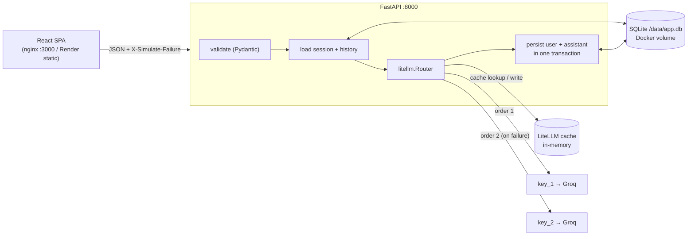

# Lyftr AI: LLM chatbot with key failover and response caching

React + FastAPI + SQLite chatbot. LiteLLM sits in front of a pool of API keys: it fails over between keys and caches responses. Every reply shows where it came from (`LIVE_INFERENCE` or `LLM_CACHE`), the model, the latency and that request's token usage.

## 1. Live URLs

| | URL |
|---|---|
| Frontend | `https://REPLACE-ME.onrender.com` (Render static site) |
| Backend | `https://REPLACE-ME.onrender.com` (Render free web service) |
| Health | `https://REPLACE-ME.onrender.com/health` |

The deployed backend runs with `ENABLE_FAILURE_SIMULATION=true`, so `X-Simulate-Failure` works there. It is on Render's free plan, so **the first request after ~15 idle minutes takes about a minute** (cold start), and chat history does not survive a restart (see *Hosting* below).

## 2. Run locally

### With Docker

```bash
cp .env.example .env        # then put two real Groq keys in LLM_API_KEYS
make up                     # builds both images and starts the stack
```

- Frontend: <http://localhost:3000>
- Backend: <http://localhost:8000/health>

`make up` creates `.env` from `.env.example` (with a warning) if it is missing. With the placeholder keys the app starts and `/health` is OK, but chats return 503 until real keys are set.

| Target | What it does |
|---|---|
| `make up` / `make down` | start / stop (history is kept in the `app-data` volume) |
| `make logs`, `make ps` | follow logs, show status |
| `make test` | backend test suite **inside the backend runtime image** |
| `make test-local` | backend (ruff + pytest) and frontend tests on the host |
| `make verify` | `scripts/verify.sh` against `BASE_URL` (default `http://localhost:8000`) |
| `make clean` | stop and **delete the volume** (all history) |

Image sizes (`docker image ls`): backend 776 MB (437 MB is the Python venv; LiteLLM alone is 195 MB), frontend 93 MB (nginx:alpine + the built SPA).

### Without Docker

Backend (Python 3.12):

```bash
cd backend
python3.12 -m venv .venv && .venv/bin/pip install -r requirements-dev.txt
cp ../.env.example .env     # set LLM_API_KEYS; for a local DB use DATABASE_URL=sqlite:///./data/app.db
.venv/bin/uvicorn --factory app.main:create_app --reload --port 8000
.venv/bin/pytest            # 92 tests, no API keys or network needed
```

Frontend (Node 22):

```bash
cd frontend
npm i
npm run dev                 # http://localhost:3000 (VITE_API_BASE_URL defaults to http://localhost:8000)
npm test                    # component + unit tests
```

No keys at hand? The tests' fake OpenAI-compatible server also runs standalone:

```bash
cd backend && .venv/bin/python -m tests.fake_upstream 9999 &
LLM_API_KEYS=a,b LLM_MODEL=openai/fake LLM_API_BASE=http://127.0.0.1:9999/v1 \
  ENABLE_FAILURE_SIMULATION=true .venv/bin/uvicorn --factory app.main:create_app --port 8000
```

## 3. Design decisions



Code map: `backend/app/llm.py` (Router, cache, simulation hook), `routes/chat.py` (request flow), `db.py` (SQLite), `config.py` (env), `main.py` (app factory, logging, error handling).

### Key fallback

- **One Router deployment per key.** All deployments share the model group `chat` and have `model_info.id = key_N` and `order = N` (in `LLM_API_KEYS` order). With `num_retries=0` the Router tries `key_1`; on any provider error it moves to `key_2`, and so on. LiteLLM does the failover; there is no hand-written retry loop.
- **Cooldowns are disabled** (`disable_cooldowns=True`). By default LiteLLM benches a deployment after a failure, which would change routing for *later* requests. Here, a failure only affects the request it happened in, and `key_id` stays deterministic.
- **What counts as a failure.** Any error is treated as "this key is unusable for this request": 429, 5xx, timeouts (`LLM_TIMEOUT_SECONDS`), and also 401/403. A revoked key should fail over, not take the app down. An **empty completion** also counts: a `litellm.post_call_rules` check raises inside the deployment call, so the Router moves on, and the empty reply is never cached.
- **All keys failed → 503.** The Router re-raises the last error. Every LiteLLM exception subclasses `openai.APIError`; those are mapped to `503 {"detail": "all providers unavailable"}`, and nothing is written.
- **`key_id` / `fallback_attempts`.** `key_id` is the answering deployment's id (`_hidden_params["model_id"]`). For `fallback_attempts`, LiteLLM's `x-litellm-attempted-fallbacks` header turned out to report `1` even when two keys had failed (3-key pool, litellm 1.110.2). So the pre-call hook records every deployment the Router tries, and `fallback_attempts = attempts − 1`. A test locks this in.
- **`X-Simulate-Failure` hook.** `/chat` parses the header into a per-key plan (`key_1=429,*=500`; a specific key overrides `*`; unknown ids are ignored; a malformed value → **422** with a clear `detail`). The plan goes into a `ContextVar` for that request only. A LiteLLM `CustomLogger.async_pre_call_deployment_hook` runs after the Router has picked a deployment and before the HTTP call. It raises the matching LiteLLM exception (`RateLimitError` 429, `InternalServerError` 500, `BadGatewayError` 502, `ServiceUnavailableError` 503), so the Router fails over exactly as on a real provider error. The header is honoured only with `ENABLE_FAILURE_SIMULATION=true` and is otherwise ignored. A test with 16 concurrent requests checks that plans never leak between requests.
- **Limitation:** two keys from the same provider account usually share rate limits and quota. Real resilience needs keys from separate accounts or providers. `LLM_MODELS` lets each key use a different model/provider (e.g. `groq/...,gemini/...`) with no code changes.

### Caching

- LiteLLM's built-in cache: `litellm.cache = Cache(type="local")` + `Router(cache_responses=True)`. A hit is detected via `response._hidden_params["cache_hit"]`.
- **Cache key = model + the full message list** (system prompt + history + new message), plus fixed call parameters. The API key is *not* part of it, so a reply cached through `key_1` is a hit when routed to `key_2`. That matches the spec ("model + messages"); a test covers it. The same first message in a new session hits; a different message, a different history or a different system prompt never does.
- **On a hit:** identical reply text, the token usage stored with the cached response, `key_id = null`, `fallback_attempts = 0`. `model` is the deployment's LiteLLM model string. (`response.model` is the provider's own name, e.g. without the `groq/` prefix, so it isn't used.)
- **Simulated requests skip the cache read** (`cache={"no-cache": True}`), so `X-Simulate-Failure` always exercises failover. Without this, re-sending an already-cached message with `*=429` would return a 200 instead of the expected 503. The successful reply is still written to the cache.
- **The cache write is asynchronous.** An identical request sent a few milliseconds later can still miss. The tests and `verify.sh` wait briefly.
- **Warm-up.** The first cache hit in a process took ~330 ms, because LiteLLM lazily imports a lot of modules on the hit path. Later hits took ~2 ms. The FastAPI lifespan runs one mock completion and its cache hit at startup, so the first real hit is fast (a cache hit must beat a live call). The hit path imports `litellm.proxy.*`, which needs `orjson` and `soundfile`. Both are pinned, and the warm-up makes a missing dependency fail at startup rather than on the first hit. CI also runs the tests inside the built image.
- **Defaults overridden:** LiteLLM's in-memory cache holds 200 items for 10 minutes. It's configured to `CACHE_MAX_ITEMS=1000` and `CACHE_TTL_SECONDS=86400`.
- **Trade-off:** the cache is per process and lost on restart. With more than one replica I'd use LiteLLM's Redis cache, so all replicas share hits. A disk cache on the `/data` volume would survive restarts; the config has a `CACHE_TYPE=disk` switch, but it isn't verified or shipped yet.

### SQLite session storage

- The `messages` table exactly as specified, plus an index on `(session_id, id)` and a `sessions` table (`session_id` PK, `system_prompt`, `created_at`, `updated_at`). The schema is created on startup (`CREATE TABLE IF NOT EXISTS`). Timestamps are UTC ISO-8601.
- **Writes happen only after success:** the user message, the assistant reply (its `metadata` column holds the full metadata JSON) and the session upsert are written in **one transaction** after a completion succeeds. A 422 or 503 leaves history untouched (tested).
- **System prompt:** per session. A `system_prompt` sent with `/chat` is stored and used for that turn and later ones. Otherwise `DEFAULT_SYSTEM_PROMPT` applies. It is never returned by the history endpoint.
- **LLM input:** `[system] + stored turns (oldest first) + new message`. `HISTORY_MAX_MESSAGES` (default 0 = unlimited) keeps only the most recent N turns, to bound context size. That naturally changes the cache key and `input_tokens`.
- `DATABASE_URL=sqlite:////data/app.db` → `/data/app.db` (the parent directory is created). WAL mode. `stdlib sqlite3` with one short-lived connection per operation, run off the event loop via the threadpool.
- `/data` is the `app-data` named volume under Compose, so history survives `make down`/`make up`. The container starts as root only to `chown /data` (platform volumes are mounted root-owned), then drops to an unprivileged user.
- **Trade-off:** SQLite means one writer and one machine. That's fine here; at scale I'd move to Postgres and keep the same repository functions.

### Hosting

- `render.yaml` is a Render Blueprint: the backend as a Docker web service (it builds the Dockerfile's last stage, `runtime`) and the frontend as a static site with an SPA rewrite. Keys and CORS origins are `sync: false`, so they are entered in the dashboard and never committed.
- **Trade-off (free plan):** the backend sleeps after ~15 idle minutes (~1 min cold start), and free services cannot mount a disk, so `/data/app.db` is wiped on every restart, redeploy or spin-down. History persists for as long as the instance is up. The fix is `plan: starter` plus the commented `disk` block in `render.yaml` (~$7/mo + $0.25/GB). `backend/fly.toml` is an alternative always-on setup with a volume (~$3/mo).
- The in-memory cache is lost on the same events. That's harmless: the next identical request is simply live again.

### Other choices

- **Contract first.** Exactly three paths: `/docs`, `/redoc` and `/openapi.json` are off unless `ENABLE_DOCS=true`. Every error is JSON with `detail`. A global handler turns unexpected exceptions into `500 {"detail": "internal server error"}` and logs the traceback server-side only.
- **Validation:** `message` is 1–4000 characters **after trimming** (so whitespace-only → 422). `session_id` is 1–128 characters and not blank. `system_prompt` is ≤ 4000.
- **Model:** `groq/openai/gpt-oss-20b`. Groq's Llama 3.x models were shut down on 2026-08-16, and this is Groq's recommended replacement (production tier, fast and cheap).
- **Logging:** one JSON line per request (request id, session id, source, key_id, fallback_attempts, latency). It never contains keys or message content. LiteLLM's own loggers are set to ERROR. Each response carries an `X-Request-ID` header.
- **Startup checks:** startup fails fast if fewer than 2 keys are configured. Configuration errors never echo the values (no keys in logs).

## 4. Verification

Set `B=http://localhost:8000` (or the deployed backend URL).

**Live call, then a cache hit** (the same first message in a new session):

```bash
curl -s $B/chat -H 'Content-Type: application/json' \
  -d '{"session_id":"demo-1","message":"What is the capital of France?"}' | jq
curl -s $B/chat -H 'Content-Type: application/json' \
  -d '{"session_id":"demo-2","message":"What is the capital of France?"}' | jq
# 1st: "resolution_source": "LIVE_INFERENCE", "key_id": "key_1"
# 2nd: "resolution_source": "LLM_CACHE", identical reply, same tokens, "key_id": null, lower latency_ms
```

**Failover:**

```bash
curl -s $B/chat -H 'Content-Type: application/json' -H 'X-Simulate-Failure: key_1=429' \
  -d '{"session_id":"demo-3","message":"Say hi"}' | jq .metadata
# "key_id": "key_2", "fallback_attempts": 1
curl -s $B/chat -H 'Content-Type: application/json' -H 'X-Simulate-Failure: key_1=500' \
  -d '{"session_id":"demo-3","message":"Say hi again"}' | jq .metadata
curl -si $B/chat -H 'Content-Type: application/json' -H 'X-Simulate-Failure: *=429' \
  -d '{"session_id":"demo-3","message":"This fails"}'
# HTTP 503 {"detail":"all providers unavailable"}; history unchanged:
curl -s $B/sessions/demo-3/messages | jq '.messages | length'    # still 4
```

**Per-message tokens and history:**

```bash
curl -s $B/chat -H 'Content-Type: application/json' -d '{"session_id":"demo-4","message":"My name is Ada."}' | jq .metadata
curl -s $B/chat -H 'Content-Type: application/json' -d '{"session_id":"demo-4","message":"What is my name?"}' | jq '.reply, .metadata'
# input_tokens grows with the history (system + history + new message); output_tokens is only this reply
curl -s $B/sessions/demo-4/messages | jq
curl -s $B/sessions/nope/messages            # 404 {"detail":"session not found"}
```

**Validation:** `-d '{"session_id":"x","message":"   "}'`, a 4001-character message, or malformed JSON → 422.

**In the UI:** every assistant reply shows a source badge (green `LIVE_INFERENCE`, purple `LLM_CACHE`), the model, latency, input/output tokens, the answering key and the fallback count. Open **Failover demo** and pick `key_1 = 429` (or `500`, `* = 429`, or a custom value). The header is then sent with each message while selected, and the badges show `key_2` and `1 fallback`. Picking `* = 429` shows the 503 message in the chat. Sending the same first message after **New chat** shows `LLM_CACHE`. Pasting more than 4000 characters shows the 422 message.

**`scripts/verify.sh`** runs every scenario above (23 checks) against any backend:

```bash
make verify BASE_URL=https://REPLACE-ME.onrender.com
```

Output against the local backend with real Groq keys (`groq/openai/gpt-oss-20b`):

```text
PASS  GET /health -> 200 {status ok, keys_configured>=2, cache_enabled true}
PASS  POST /chat live -> LIVE_INFERENCE with full metadata
PASS  same first message in new session -> LLM_CACHE, key_id null, fallback 0
PASS  cache hit returns the identical reply
PASS  cache hit reports the stored token usage in=100 out=59
PASS  cache hit is faster than the live call cache=2ms live=690ms
PASS  a different message is not served from cache LIVE_INFERENCE
PASS  multi-turn: the bot remembers the name from turn 1
PASS  GET /sessions/{id}/messages -> 4 messages, oldest first, metadata on assistant
PASS  unknown session -> 404 {detail: session not found}
PASS  422: missing message
PASS  422: missing session_id
PASS  422: empty message
PASS  422: whitespace-only message
PASS  422: message over 4000 chars
PASS  422: empty session_id
PASS  422: malformed JSON
PASS  422 requests write nothing to history
PASS  X-Simulate-Failure: key_1=429 -> 200 answered by key_2 {"key_id":"key_2","fallback_attempts":1,...}
PASS  X-Simulate-Failure: key_1=500 -> 200 answered by key_2
PASS  X-Simulate-Failure: *=429 -> 503 {detail: all providers unavailable}
PASS  *=429 adds nothing to history before=4 after=4
PASS  simulation does not leak: next request answered by key_1

23 passed, 0 failed
```

Output against the deployed backend: `TODO (paste here after deploying)`.

**Automated tests:** `backend/tests` has 92 pytest tests. They run against a fake OpenAI-compatible HTTP server, through the real LiteLLM Router, cache and exception mapping, with nothing in LiteLLM mocked. They cover every case above plus real upstream 429/500/401/empty/timeout failover, 3-key ordering, cache-key edge cases, concurrency and the no-traceback 500. `frontend/src/*.test.ts(x)` checks the `data-testid` contract, Enter/Shift+Enter, input clearing, the request body and headers, and the 422/503/network error rendering.

## 5. Setup Used

TODO: editor and AI tools.

## 6. Bonus features

- **Failover demo panel in the UI.** Presets for `X-Simulate-Failure` let you show failover and the 503 path without curl.
- **`key_id` and `fallback_attempts` badges, colour-coded source.** Failover and cache hits are visible at a glance.
- **`scripts/verify.sh`.** One command checks the whole contract against any deployment (PASS/FAIL, non-zero exit on failure).
- **CI (GitHub Actions).** Ruff + pytest, frontend typecheck/tests/build, `docker compose build`, the backend tests **inside the built runtime image** (which catches dependency gaps on the cache-hit path), and a Compose smoke test.
- **Simulation bypasses the cache read.** Failover demos stay deterministic even for cached messages.
- **Empty-reply failover.** A blank completion counts as a key failure and is never cached.
- **Startup cache warm-up.** The first real cache hit takes ~2 ms instead of ~330 ms.
- **Per-session system prompt** persisted in SQLite, plus `DEFAULT_SYSTEM_PROMPT`.
- **`HISTORY_MAX_MESSAGES`.** Bounds context and cost for long chats.
- **`LLM_MODELS`.** One model per key, to mix providers (true provider failover, not just key rotation).
- **Runtime frontend config.** The nginx image writes `/config.js` from `API_BASE_URL` at start, so one image works against any backend.
- **Structured JSON logs with `X-Request-ID`**, with no keys or message content.
- **Fake upstream server** (`python -m tests.fake_upstream`) for running the whole stack without API keys.
